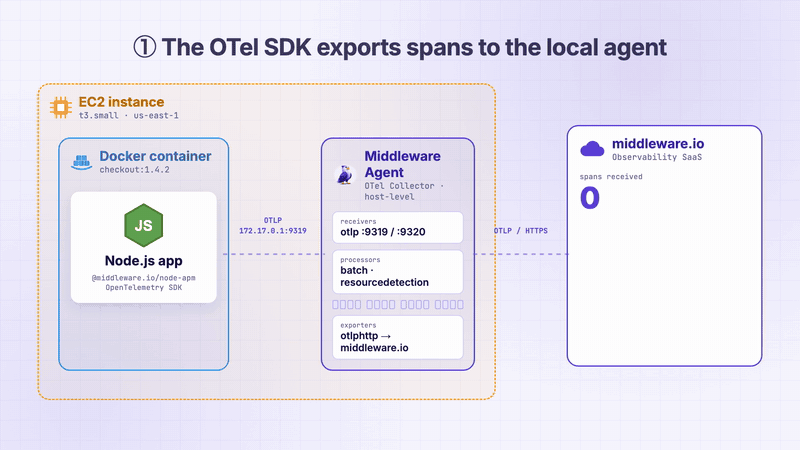
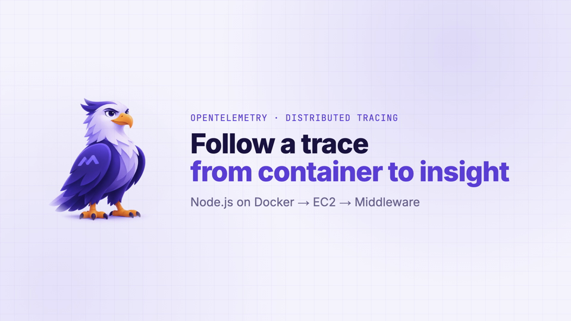
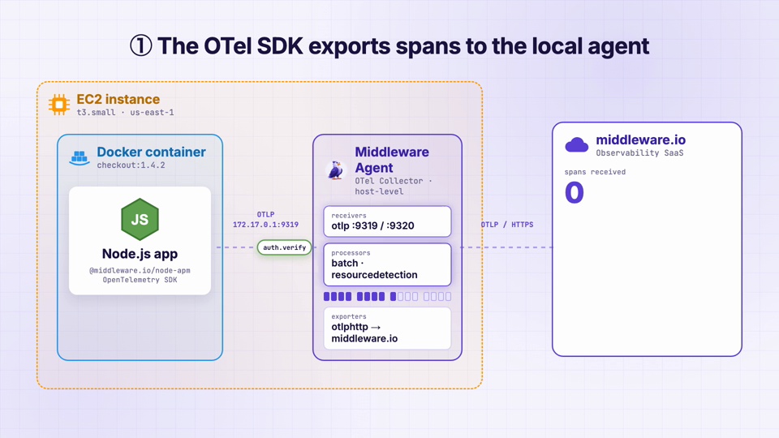
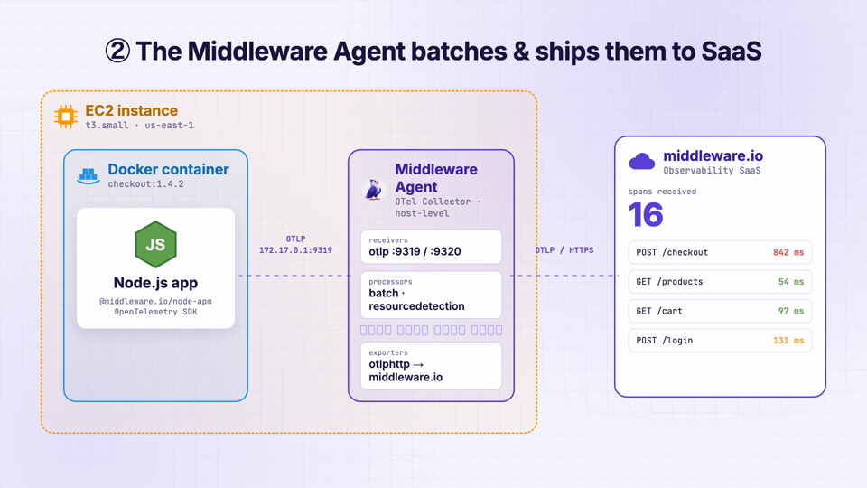
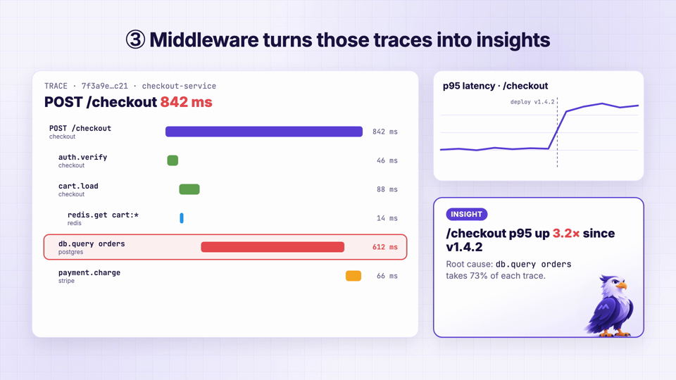

# Code-Driven Explainer Video: Distributed Tracing with Middleware

**A 42-second product explainer made entirely in code with [Remotion](https://www.remotion.dev) and an [ElevenLabs](https://elevenlabs.io) voiceover. There's no timeline editor, and no keyframes were placed by hand.**

<p align="center">
  
</p>

<p align="center">
  <a href="docs/middleware-traces.mp4"><b>▶ Watch the full video (MP4, 1080p, 42 s)</b></a>
</p>

---

## Overview

The video follows **one request through an observability stack**. A Node.js app in Docker on EC2 sends OpenTelemetry spans to the Middleware Agent. The agent batches them and ships them to Middleware, which builds a trace waterfall and finds the root cause of a latency spike.

Each frame is drawn by React components, and the visuals stay in sync with a generated voiceover. That makes this a reusable pattern for **technical product documentation**:

- **Versioned like code.** Scripts, diagrams and timing live in Git and change through pull requests.
- **Easy to update.** Editing a line of narration and re-running one command re-voices the video and re-times every scene.
- **Accurate to the product.** Port numbers, package names, span names and pipeline stages come from real config.
- **On brand.** One theme file holds the colors, fonts and easing used in every scene.

| | |
|---|---|
| **Length** | 41.6 s · 1,246 frames |
| **Format** | 1920×1080 · 30 fps · H.264 |
| **Scenes** | 4 (Intro → Pipeline → Insights → Outro) |
| **Voiceover** | 6 clips · ElevenLabs `eleven_multilingual_v2` |
| **Source** | ~1,270 lines of TypeScript/React |

## Storyboard

| | |
|---|---|
|  |  |
| **Intro.** Sets up the story: one trace, from container to insight. | **① Instrument.** The OTel SDK in the container exports spans over OTLP to the agent on the host. |
|  |  |
| **② Collect.** The agent's receivers, processors and exporters light up as span batches stream to the SaaS backend. | **③ Analyze.** The trace waterfall builds, the p95 latency chart spikes after deploy v1.4.2, and the slow `db.query` is flagged as the root cause. |

## How it was built

### 1. Remotion agent skills to build the scenes

The project was written with an AI coding agent using the [Remotion agent skills](https://github.com/remotion-dev/skills) (`remotion-best-practices`, `remotion-create`, `remotion-markup`, `remotion-multimedia`, `remotion-render` and others, pinned in `skills-lock.json`). The skills teach the agent Remotion's conventions:

- Animation is a **pure function of the frame**: `useCurrentFrame()` + `interpolate()` with clamped ranges and a shared `Easing.bezier(0.16, 1, 0.3, 1)` curve. No CSS transitions or timers.
- Scenes are composed with `<Sequence>`, and scenes and audio are grouped into named `<Track>`s so the Remotion Studio timeline is easy to read.
- Fonts come from `@remotion/google-fonts` (Inter, JetBrains Mono), so renders are deterministic.
- Audio durations are read with `mediabunny` inside `calculateMetadata`.

### 2. ElevenLabs voiceover generated from a script

The narration lives in [`src/voiceover.ts`](src/voiceover.ts) as one line per story beat. [`scripts/generate-voiceover.ts`](scripts/generate-voiceover.ts) sends each line to the ElevenLabs text-to-speech API and saves an MP3 per beat:

```ts
body: JSON.stringify({
  text: line.text,
  model_id: "eleven_multilingual_v2",
  // Stitch prosody across clips so the beats sound like one read.
  previous_text: NARRATION[i - 1]?.text,
  next_text: NARRATION[i + 1]?.text,
}),
```

Passing `previous_text` and `next_text` keeps intonation continuous across clips. The six separate files sound like one take, but each one can still be re-recorded on its own.

### 3. Timing driven by the audio

This is what makes the approach practical for docs. **Scene lengths aren't hard-coded. They're computed from the voiceover.**

```
voiceover.ts ──► ElevenLabs ──► public/voiceover/*.mp3
                                         │
                       calculateMetadata (measure each clip with mediabunny)
                                         │
                               computeTiming(frames)  ← src/timing.ts
                                         │
          scene durations · beat boundaries · span emission rate · total length
```

[`src/timing.ts`](src/timing.ts) turns each clip's length into scene durations and in-scene beats. For example, the moment the spans start flowing lines up with the word "Middleware APM package", and the rate spans are emitted at stretches to fill that sentence. If a line gets rewritten and is longer or shorter, the whole video re-times itself.

### 4. Visual system

- **[`theme.ts`](src/theme.ts)** holds the brand palette, technology accent colors (AWS orange, Docker blue, Node green), fonts and the easing curve.
- **[`Appear.tsx`](src/Appear.tsx)** is a reusable fade, rise and scale entrance used for staggered reveals.
- **[`Pipeline.tsx`](src/scenes/Pipeline.tsx)** is a laid-out architecture diagram with animated span "packets", a batch buffer, and collector stages that pulse when data passes through.
- **[`Insights.tsx`](src/scenes/Insights.tsx)** contains a trace waterfall, a latency chart with a deploy marker, and an insight card that highlights the root cause.

## Project structure

```
src/
├── Root.tsx              Composition + calculateMetadata (audio → duration)
├── TracesVideo.tsx       Scene and voiceover tracks
├── timing.ts             Audio-driven scene/beat timing
├── voiceover.ts          Narration script + voice config
├── theme.ts              Colors, fonts, easing
├── Appear.tsx · Background.tsx · Icons.tsx
└── scenes/
    ├── Intro.tsx
    ├── Pipeline.tsx      EC2 → Docker → Agent → SaaS data flow
    ├── Insights.tsx      Trace waterfall, latency chart, root cause
    └── Outro.tsx
scripts/generate-voiceover.ts   ElevenLabs TTS
public/voiceover/*.mp3          Generated narration
```

## Run it

```bash
npm i                                   # install
npm run dev                             # preview in Remotion Studio
npx remotion render MiddlewareTraces    # render to out/MiddlewareTraces.mp4

# Re-generate the narration after editing src/voiceover.ts
ELEVENLABS_API_KEY=... npm run voiceover
```

Requires Node 20.19+, 22.13+ or 24+.

## Reusing the pattern

To make an explainer for a different feature:

1. Write the narration in `src/voiceover.ts`, one line per beat.
2. Run `npm run voiceover`.
3. Build scenes that read their beat boundaries from `computeTiming()`.
4. Render.

The voiceover, timing and visual system carry over unchanged.

---

<sub>Built with Remotion and ElevenLabs. Remotion is free for individuals and small teams; larger companies need a [company license](https://www.remotion.dev/license).</sub>
